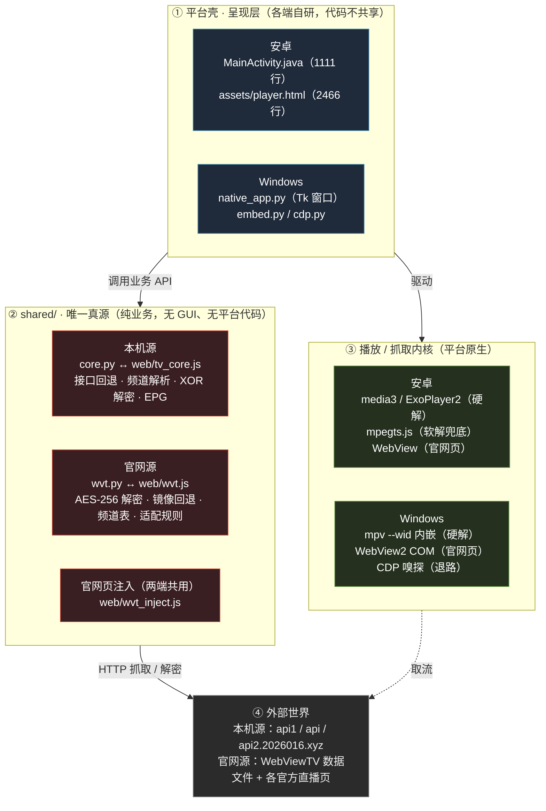
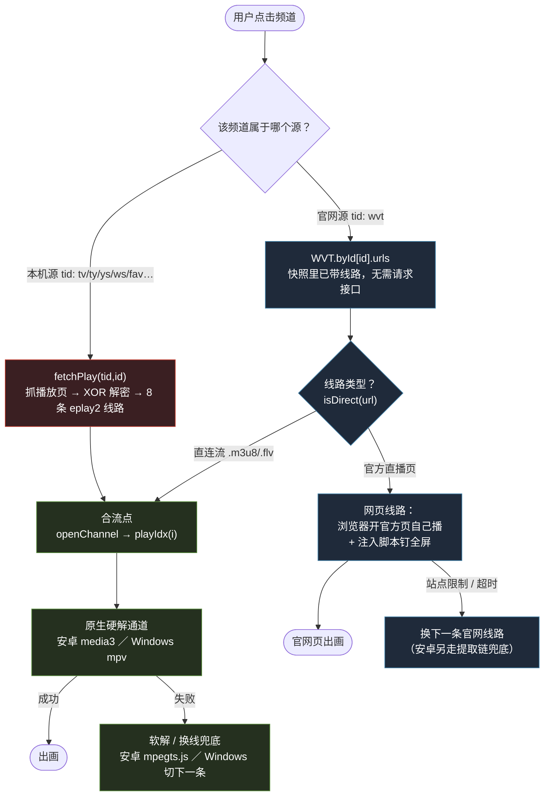
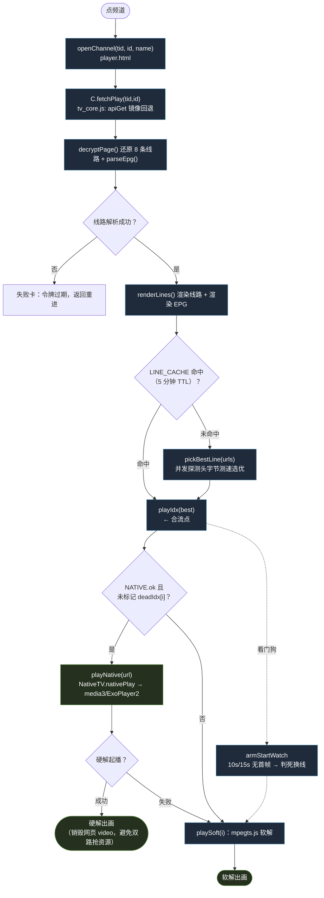
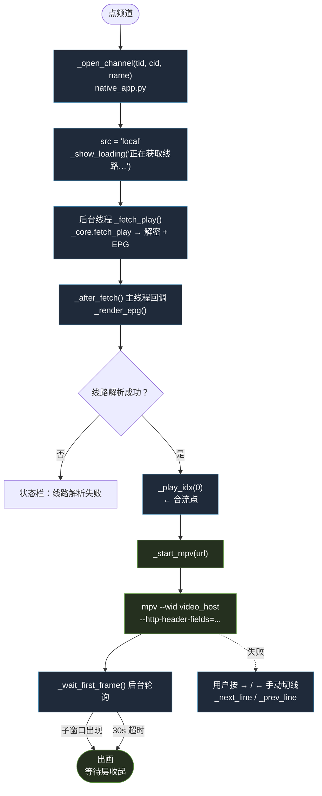
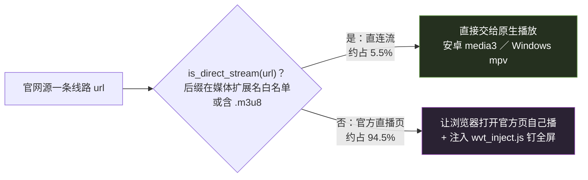
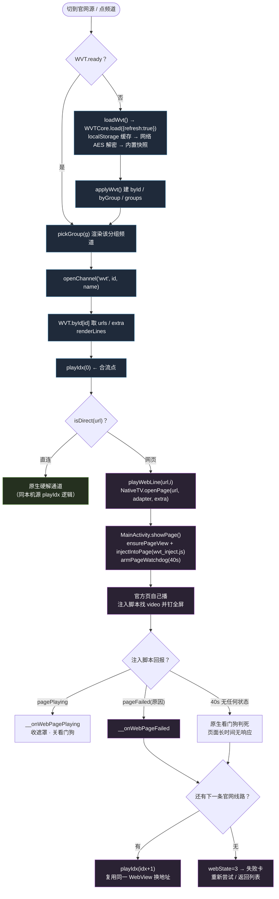
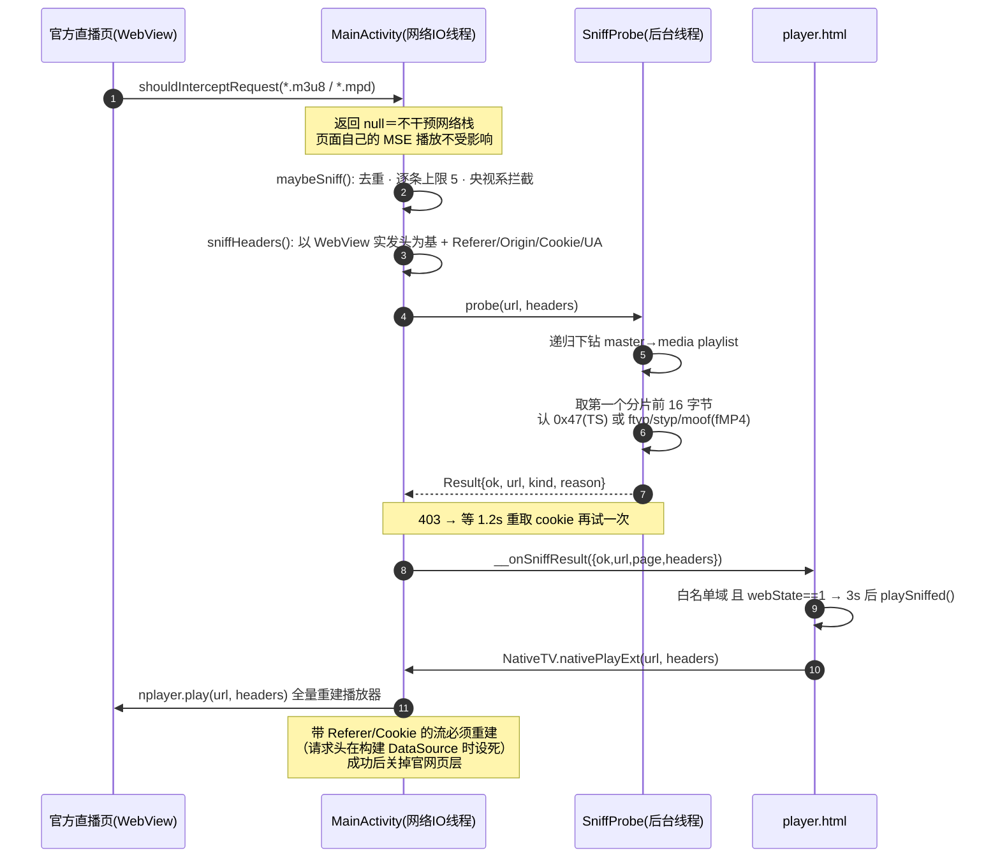
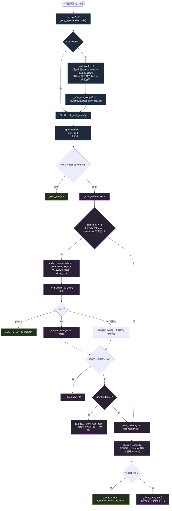

# 纯净电视 · 两源（本机源 / 官网源）× 两端（安卓 / Windows）实现架构与流程图

> 本文是**最终版**的架构参考：把两条数据源在安卓端、Windows 端的完整链路（数据获取 → 线路解析 → 播放 → 兜底）
> 用架构图 + 流程图 + 文字说明一次性讲清楚，供维护、排障、新人接手时对照。
>
> 对应代码版本：v2.9（2026-10-11）。图里的每条边都能在代码里找到落点，文件与函数名均给出。
>
> 📄 同目录另附 **`架构与流程图-两源两端.html`**（离线、内嵌已渲染好的 SVG，无外部依赖）——
> 用不支持 Mermaid 的编辑器看 `.md` 时，直接打开 HTML 即可看到全部图表。
> 两份内容一致，`.md` 是唯一真源；改了 `.md` 后重新渲染 HTML 即可（见文末「附：如何重新渲染」）。

---

## 0. 一页速览：两源 × 两端 矩阵

| | **安卓端**（`android/`） | **Windows 端**（`desktop/`） |
|---|---|---|
| **本机源**<br>私有 App 后端 | 数据：`shared/web/tv_core.js`<br>壳：`player.html` + `MainActivity.java`<br>播放：**media3 / ExoPlayer2 原生硬解** → 兜底 mpegts.js 软解 | 数据：`shared/core.py`<br>壳：`native_app.py`（Tk）<br>播放：**mpv 原生硬解**（`--wid` 内嵌） |
| **官网源**<br>WebViewTV 数据 + 官方直播页 | 数据：`shared/web/wvt.js` + 内置快照<br>网页线路：**覆盖层 WebView + 注入 `wvt_inject.js`**<br>直连线路：原生硬解<br>★ v2.9 **`shouldInterceptRequest` 提取 → 原生硬解** | 数据：`shared/wvt.py` + 内置快照<br>网页线路：**WebView2 COM 内嵌（SetParent）+ 注入同一份脚本**<br>直连线路：mpv<br>兜底：**CDP 嗅探 → mpv** |
| **播放入口** | `openChannel(tid,id,name)`（JS） | `_open_channel(tid,cid,name)`（Py） |
| **合流点** | `playIdx(i)` | `_play_idx(idx)` |
| **源切换** | 顶栏 `setSrc("local"/"wvt")` | 顶栏 `_set_src("local"/"wvt")` |
| **两端共用** | `shared/web/wvt_inject.js`（官网页注入，安卓与桌面**同一份**） | ← 同左 |

**一句话结论**：两源**只在「数据获取层」分叉**——本机源走私有接口 + XOR 解密，官网源走 AES 加密的 `.dat` 快照；
**播放层早已统一**，都汇聚到 `openChannel → playIdx` 这一条主干，因此「换个源」不需要改任何播放逻辑。

---

## 1. 全局分层架构图

四层：**外部数据源 → shared 业务核心（唯一真源）→ 平台壳（呈现层）→ 播放/抓取内核**。
共享层只放业务，不放 GUI；平台差异全部收敛在壳层与内核层。



**维护铁律（对应 `shared/README.md`）**：
`core.py` 与 `web/tv_core.js` 是一对镜像，改一必须改二；`wvt.py` 与 `web/wvt.js` 同理；
`android/app/assets/{tv_core.js,wvt.js,wvt_inject.js}` 是 `build.sh` 自动拷贝的副本，**永远不要直接改**。

---

## 2. 两源分流总览

两套频道表结构完全不同（本机源是 `tid` 分类 + 接口实时拉取；官网源是 51 个 `group` 分组 + 静态快照 904 频道），
**不合并、不互相转换**；两端都采用「顶栏切换 + 各自记忆浏览位置」。分流只发生在数据层，
一旦进入 `openChannel / playIdx`，后面完全一致。



---

## 3. 本机源（local）

### 3.1 数据链路（业务核心）

| 环节 | Python（`shared/core.py`） | JS（`shared/web/tv_core.js`） |
|---|---|---|
| UA 伪装 | `APP_UA`（含 `LT-APP/48/517`，服务器据此返回新版播放器页） | 由原生 `WebSettings.setUserAgentString` 设置 |
| 接口域名回退 | `api_get()` + `API_MIRRORS`（api1 / api / api2，同源） | `apiGet()` + `TVCore.API_MIRRORS` |
| 频道列表 | `fetch_channels()` → `/iptve.php?tid=<tid>&app=517` | `fetchChannels()` |
| 播放页 + 解密 | `fetch_play()` → `decrypt_page()` | `fetchPlay()` → `decryptPage()` |
| EPG | `parse_epg()` | `parseEpg()` |

**解密要点**（两版必须逐字节一致）：
`option 值反转 → base64 解 → XOR(key) → base64 解 → 换 token → 去盐前缀 → 补 &type=.flv`。
**key 不靠算盐**：用第 1 条线路的**已知明文模板** `<API>/eplay2.php?token=<旧>&tid=..&id=..&p=0&type=.flv`
与自造的同构密文异或反推，所以无论服务器 deviceId/日期怎么变都能解全页。
★ **抓页与解密必须同域**：`api_get()` 命中哪个镜像就把 `API` 全局切过去。

### 3.2 安卓端 · 本机源流程

关键点：**优先原生硬解**（`NATIVE.ok` 且该线路没硬解失败过），失败才回落 `mpegts.js` 软解；
硬解失败只标记**那条线路**（`NATIVE.deadIdx[i]`，v2.7），换下一条线路重新给一次原生机会。



> 安卓端没有「嗅探」这一步——本机源线路本来就全在解密结果里，是明文直链。

### 3.3 Windows 端 · 本机源流程

关键点：**不做测速选路**（直接顺序切线），播放交给 `mpv`，用 `--wid` 把 mpv 的视频子窗口钉进 Tk 的
`video_host`；首帧信号靠枚举 `video_host` 下的**原生大子窗口**（`_mpv_child()`）判定。



> ★ **mpv `--http-header-fields` 逗号坑**：该选项按逗号分隔条目，UA 里的 `KHTML, like Gecko`
> 必须转义成 `\,`，否则 mpv 2 秒退出无输出（见 `_header_fields`）。

### 3.4 本机源 · 两端对比

| 维度 | 安卓 | Windows |
|---|---|---|
| 数据核心 | `web/tv_core.js` | `core.py` |
| 线路来源 | 接口实时解密 | 接口实时解密 |
| 选路 | **并发测速** `pickBestLine` + 5 分钟缓存 | 不测速，顺序切线 |
| 播放 | media3 / ExoPlayer2 硬解 → mpegts.js 软解 | mpv 硬解 |
| 起播看门狗 | `armStartWatch`（10s/15s） | `_wait_first_frame`（30s） |
| 线程约束 | `nativeStats` 必须弹回主线程（media3 线程校验） | Tk 主线程 + 后台线程经 `_ui` 队列排水 |

---

## 4. 官网源（wvt）

### 4.1 数据链路与线路两类

**数据**：WebViewTV 的 `.dat` 数据文件（AES-256-CBC + gzip），经「本地缓存(24h) → 多镜像下载(总预算) → 内置快照」三级获取。

| 环节 | Python（`shared/wvt.py`） | JS（`shared/web/wvt.js`） |
|---|---|---|
| 密钥 | `_expand_key()` 由 `_APP_CLASS` 派生 | `KEY_STR` / `IV_STR`（`keyInfo()` 自检） |
| AES 解密 | `aes_cbc_decrypt()` | `aesCbcDecrypt()` |
| gzip | 标准库 `gzip` | `DecompressionStream("gzip")` |
| 频道表 | `load_channels()` | `WVTCore.load()` / `refresh()` |
| 适配规则 | `load_adapters()` / `match_adapter()` | `WVTCore.matchAdapter()` / `defaultAdapter()` |
| 直链判定 | `is_direct_stream()` | `WVTCore.isDirect()` |
| 内置快照 | `builtin_snapshot()` | `WVTCore.snapshot()`（读 `window.WVT_SNAPSHOT`） |

**线路分两类**（这条分叉决定了后面走哪条播放通道）：



**为什么网页线路不能简单「嗅探出流地址给原生播」**：
CCTV / 央视频等站用 WASM + MSE 播 `blob:` 源，抓出来的地址原生播放器用不了；
且**央视系是 TS 载荷级私有加扰**（路径带 `cdrm`）——无 `#EXT-X-Key`、分片首字节仍是 `0x47`，
探测会「通过」，但原生解出来**全是花屏且静默不报错**，无法自动回退。
所以策略是：**能提取且确认干净的才交原生，其余一律让网页自己播**。

### 4.2 安卓端 · 官网源流程

网页线路走**覆盖层 WebView**（`pageView`）加载官方页 + 注入 `wvt_inject.js`（元素留原地·钉 `position:fixed` 全屏）；
v2.9 起增加**提取链**：`shouldInterceptRequest` 旁听 `*.m3u8` → 后台 `SniffProbe` 探测 → 结论推回网页侧。



#### 4.2.1 提取链细节（v2.9，安卓独有）

这是本轮新增能力：**安卓的 WebView 本来就加载着官方页，用 `shouldInterceptRequest` 旁听请求即可截流，
零额外开销**（不像桌面端要另起浏览器 + CDP，冷启动 30s+）。截到 ≠ 能播，所以还要后台探测一遍。



**三处安全阀**（缺一不可）：
1. **央视系域名单拦**：`blockedReason(low)` 命中 `cctv.com / cntv.cn / yangshipin / /cdrm` → 直接判「不可播」，保持网页播放；
2. **白名单优选**：只有 `SNIFF_SAFE`（15 站实测「嗅到就能干净播」的 10 个域名，如 `m.gdtv.cn / itouchtv.cn / nmtv.cn …`）才**主动切**原生硬解；
3. **其他域仅兜底**：非白名单的提取结果只在「这条网页线路起播失败」时用作兜底直链，不主动切。

> ★ **「不能只认第一条 m3u8」**（v2.9 实测踩到的坑）：`m.gdtv.cn` 这类站点**第一次**请求的 m3u8
> 拿不到数据（`transferSize=0`），页面随即用新 token 请求第二条才成功。只认第一条的话探测永远打在废地址上，
> 结果恒 403。所以 `maybeSniff` 允许**逐条探测**（`MAX_SNIFF_TRIES=5`），谁探通就用谁。

### 4.3 Windows 端 · 官网源流程

网页线路走 **WebView2 COM 内嵌**（`embed.py`，专职 STA 线程 + `SetParent` 把浏览器子窗口钉进 `video_host`）
+ 注入**同一份** `wvt_inject.js`；`_web_watch` 每秒轮询页面状态。
没有 Edge/Chrome 时退到 **CDP 嗅探**（`cdp.py`）→ 提取真流地址 → mpv 直连。
**三级兜底**：网页线路逐条自动换线 → 全部失败走 CDP 嗅探真流 → 嗅探也失败才报「均不可用」（VIP 类跳过嗅探）。



> ★ **桌面端独有约束**：`embed.py` 用「WebView2 COM 直调 + 专职 STA 线程 + MsgWait 泵」，
> `EXTRA_ARGS` 可用 `WVT_EMBED_ARGS` 覆盖；Tk 后台线程**严禁**跨线程 `root.after`（走 `_ui` 队列）；
> `_eval_sync` / `close()` 这类「等待泵」绝不能跑在 Tk 回调里（否则 DispatchMessage 嵌套进 Tcl → GIL 段错误）。

### 4.4 官网源 · 两端对比

| 维度 | 安卓 | Windows |
|---|---|---|
| 数据核心 | `web/wvt.js` + `wvt_channels.js` | `wvt.py` + `wvt_builtin.json` |
| 直连线路播放 | media3 / ExoPlayer2 硬解 | mpv |
| 网页线路载体 | **覆盖层 WebView**（同 App 内） | **WebView2 COM 内嵌**（SetParent 进 Tk 窗口） |
| 注入脚本 | `wvt_inject.js`（两端**同一份**） | 同左 |
| 网页失败换线 | `__onWebPageFailed` → `playIdx(idx+1)` | `_on_web_state('failed')` → `_play_idx(idx+1)` |
| 提取真流 | **`shouldInterceptRequest` 旁听 + `SniffProbe`**（v2.9，零额外开销） | **CDP 嗅探**（冷启动 10~30s，仅退路） |
| 提取后播放 | `nativePlayExt` 全量重建播放器（带 Referer/Cookie） | `_start_mpv(headers=…)` |
| 原生看门狗 | 40s（`armPageWatchdog`） | 35s（`_web_watch` 内） |
| 失败终态 | `showWebDeadCard`（可重试/回列表/跳相邻频道） | `_show_web_dead` + 占位文字 |

---

## 5. 跨端关键设计约束（排障必查）

| # | 约束 | 影响 / 坑 |
|---|---|---|
| 1 | **`shared/` 是唯一真源**，两端只改共享层，副本由 `build.sh` 生成 | 直接改 `android/app/assets/tv_core.js` 下次构建即被覆盖 |
| 2 | **解密不用算盐**：用第 1 条线路已知明文反推 XOR key | 改解密必须 `core.py` 与 `tv_core.js` 一起改 |
| 3 | **UA 是命门**：`LT-APP/48/517` 决定服务器给新版播放器页 | 浏览器改不了 UA → 安卓必须原生 WebView，桌面必须原生端抓取 |
| 4 | **抓页与解密必须同域**：`api_get()` 命中哪个镜像就把 `API` 切过去 | 不同域会拿到对不上的密文 |
| 5 | **官网页注入 11 条铁律**（`wvt_inject.js`） | 不搬 `<video>` 出原 DOM 子树；`unclip()` 不越过 `#__wvt_host`；用 `currentTime>0.2` 判起播；只留一条轮询链；压掉页面 `zoom`；尺寸基准取「视觉视口」… |
| 6 | **桌面 Tk / WebView2 线程铁律** | 后台线程严禁跨线程 `root.after`；超时状态必须**原生看门狗**兜（页面 JS 拖死渲染器时注入脚本发不出超时） |
| 7 | **mpv `--http-header-fields` 值内逗号必须转义 `\,`** | 值里的 `KHTML, like Gecko` 会崩掉整个选项解析（mpv rc=2 秒退） |
| 8 | **Win32 子窗口不跟随父窗口 resize** | mpv / WebView2 都靠 `put_Bounds` / `_fit_now` 手动铺满 —— 「全屏缺画面」的唯一根因 |
| 9 | **央视系 `cdrm` 是静默花屏** | 提取也白提，只能靠网页播放；判据不能是 HTTP 200 或分片首字节 |
| 10 | **「只认第一条 m3u8」会恒 403** | 必须逐条探测，谁探通用谁 |
| 11 | **`nativeStats` 必须弹回主线程** | media3 ExoPlayer 有线程校验，直调必抛异常被吞成 `{}` |

---

## 6. 代码地图（按职责定位）

| 职责 | 安卓 | Windows | 共享核心 |
|---|---|---|---|
| 本机源数据 | `assets/player.html` 调 `tv_core.js` | `native_app.py` 调 `core.py` | `core.py` ↔ `web/tv_core.js` |
| 官网源数据 | `assets/wvt.js` + `wvt_channels.js` | `native_app.py` 调 `wvt.py` | `wvt.py` ↔ `web/wvt.js` |
| 官网页注入 | `assets/wvt_inject.js` | `embed.py` 读 `shared/web/wvt_inject.js` | `web/wvt_inject.js`（**唯一一份**） |
| 原生硬解 | `NativePlayer.java` → `Media3PlayerBackend.java` / `Exo2PlayerBackend.java` | `native_app.py` `_start_mpv()` → mpv | — |
| 官网页承载 | `MainActivity.java` `pageView` / `showPage()` | `embed.py` `EmbeddedBrowser`（WebView2 COM） | — |
| 流提取 | `MainActivity.maybeSniff()` + `SniffProbe.java` | `cdp.py` `sniff_stream()` | — |
| 硬解失败降级 | `NATIVE.deadIdx` → `playSoft()`（mpegts.js） | `_next_line()` 顺序切线 | — |
| 起播看门狗 | `armStartWatch` + `armPageWatchdog` | `_wait_first_frame` + `_web_watch` | — |

---

## 7. 一句话记忆

> **数据分两源，播出一条路。**
> 本机源＝私有接口 + XOR 解密；官网源＝AES 快照，线路再分「直连流」与「官方直播页」。
> 直连流永远交原生硬解；官方直播页让浏览器自己播，安卓用覆盖层 WebView、Windows 用 WebView2 内嵌，
> 两端注入**同一份** `wvt_inject.js`。官网源能干净提取的（白名单 / CDP 兜底）才转交原生，
> 央视系加扰的**只能**网页播。

---

## 附：如何重新渲染 HTML

`.md` 是唯一真源。改完图或文字后，用 `tools/render_doc_mermaid.mjs` 重新生成同名的离线 HTML
（用本机已装的 Edge/Chrome 把 Mermaid 渲成内嵌 SVG，产物零外部依赖）：

```bash
# 依赖只装在 workbuddy 的 node 工作区（不污染项目）：
cd ~/.workbuddy/binaries/node/workspace
npm i mermaid puppeteer-core marked

# 渲染（路径按需替换）：
cd <仓库根>
node tools/render_doc_mermaid.mjs 架构与流程图-两源两端.md 架构与流程图-两源两端.html
# 期望：逐块打印「渲染 OK #N」，最后「已写出 … (≈700 KB)」
```

> 校验 Mermaid 语法（不渲染、只解析，快）也可直接跑：
> `node -e "..."` 见开发手册；或肉眼在 GitHub / VS Code（装 Mermaid 插件）里预览 `.md`。
